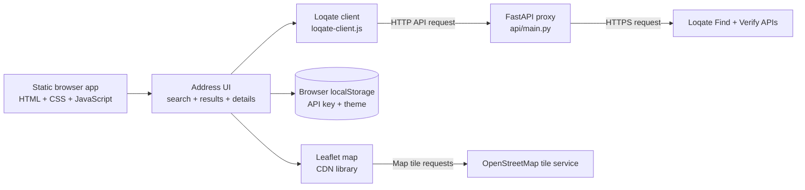
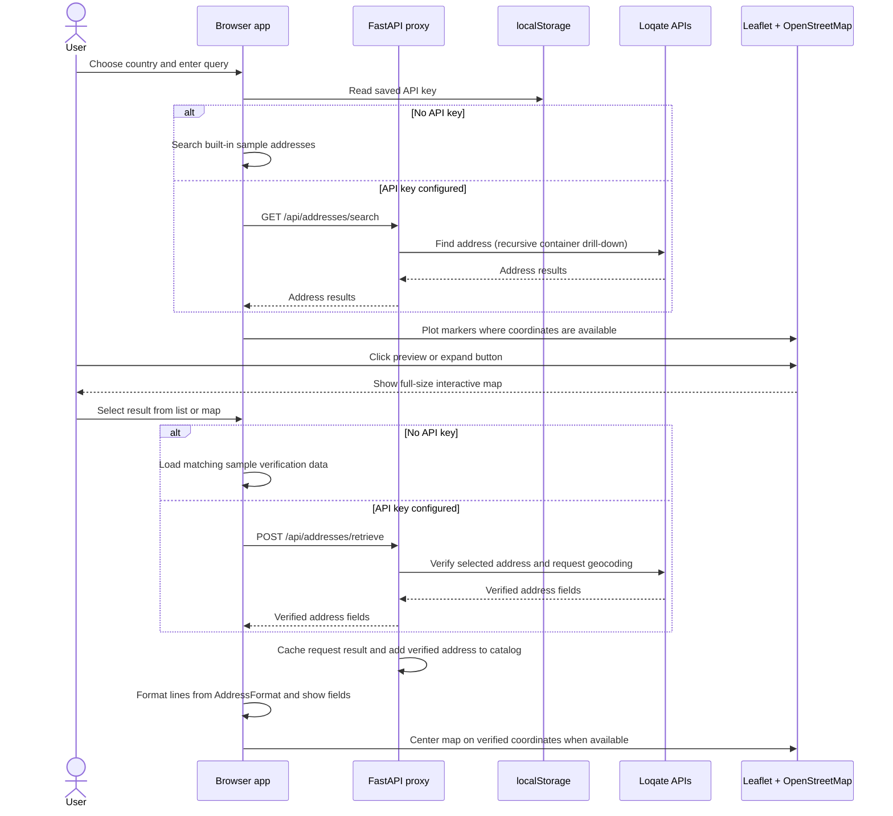

# POC Address Application Design

This note describes the current Address proof of concept, as published on the
[documentation page](C:/Source/Repos/poc-address/docs/documentation.html). The implementation
uses the same browser-native approach as the Asset POC: static HTML, CSS, and
JavaScript, without a frontend framework or build system.

## Architecture

The app loads directly as a static page. The interface and application logic are in
`src/poc-address-app.html`; the request helpers are in
`src/loqate-client.js`; the Loqate proxy is implemented in `api/main.py`. Leaflet
is loaded from unpkg.com and OpenStreetMap provides map tiles. There is no
frontend framework runtime, database, or build step.

## Address lookup flow

The supported country list is embedded in the page. Without a key, only the included
sample searches (`tf26rf` and `EC2M 7NH`) return data. With a key, the browser
sends the `X-Loqate-Api-Key` header to the FastAPI proxy, which calls Loqate. The
API key field is in the search section.

The results map is a compact 165-pixel preview, like the Asset POC. Click the
preview or expand button to open a full-size interactive map. Result markers can
be selected from either view; the expanded map also supports panning and zooming.

## Components

| Component | Responsibility |
|-----------|----------------|
| `poc-address-app.html` | Static interface, styles, search and API key controls, map setup, sample responses, result selection, and address rendering |
| `loqate-client.js` | Calls the local FastAPI address endpoints and provides catalog filtering |
| `api/main.py` | FastAPI proxy for Loqate Find and Verify, including recursive Find container drill-down, in-memory caching, and the verified-address catalog |
| Leaflet | Compact map preview, result markers, and expanded interactive map |
| OpenStreetMap | Map tiles and attribution for both map views |
| Browser `localStorage` | Stores the Loqate key under `loqate_api_key` and theme preference under `poc-address.theme.v1` |

## Address formatting

Loqate's `AddressFormat` value provides field names grouped into address lines with
` ` separators. The app splits the format into lines, resolves each field from the
verification response, and displays non-empty values. When no format is supplied, it
falls back to the response's `Address` field.

## Framework and runtime

The application is plain browser-native HTML, CSS, and JavaScript. It has no package
manifest, frontend framework runtime, or compile step. The FastAPI proxy exposes
`/health`, `/heartbeat`, `/api/addresses/search`, `/api/addresses/retrieve`, and
`/api/addresses/catalog`; `LoqateClient.catalog()` retrieves verified records and
`LoqateClient.filterCatalog()` applies local query and country filters.
FastAPI publishes interactive documentation at `/docs`. The local Podman runner
builds `api/Containerfile`, starts the proxy, and serves the browser client.
GitHub Pages publishes the app as `docs/index.html` and the standards guide as
`docs/documentation.html`.

## Security and limitations

- The Loqate API key is saved in browser `localStorage` and sent to the proxy in
  `X-Loqate-Api-Key`. This is not a production secret store.
- The proxy cache and verified-address catalog are in-memory and expire after five
  minutes by default; they are not durable address records or a user account.
- Leaflet and OpenStreetMap require network access.
- The built-in examples are fixed fixtures, not a local address database.
- Map pins and geocodes do not prove postal deliverability, ownership, or legal
  status.

The documentation page's UPU S42 content is explanatory; the app delegates live address
formatting and verification to Loqate rather than implementing a separate standard
engine.
